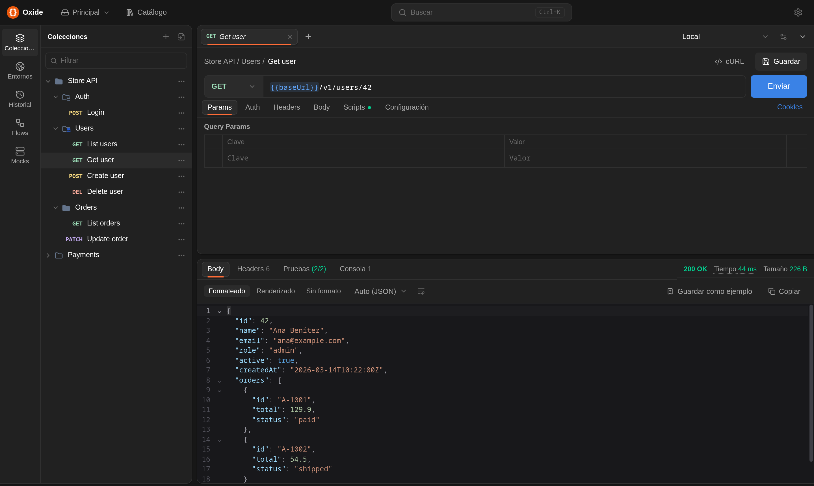
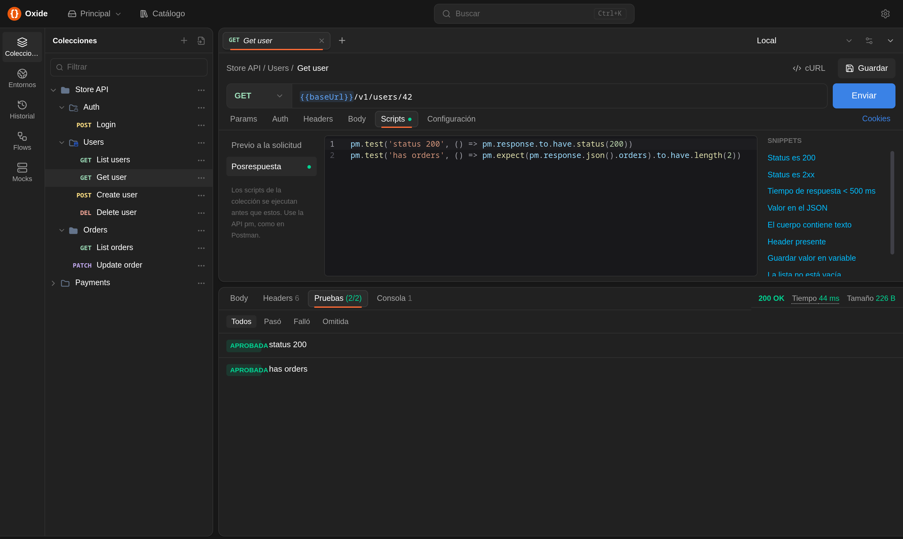

  

<h1 align="center">Oxide</h1>

  <b>A fast, offline desktop API client — a free alternative to Postman.</b> 
  Send requests, organize collections, write tests, run mock servers and version your workspace in Git. 
  No account and no cloud required.

  <a href="../../releases/latest"><b>⬇ Download the latest version</b></a>
  &nbsp;·&nbsp; Windows · macOS · Linux

  

---

## Why Oxide

- **Works offline, without an account.** Your collections stay on your computer.
- **Fast.** Requests run on a native engine written in Rust.
- **Imports what you already have.** Postman collections (v2.1), OpenAPI / Swagger, cURL — and routes read straight from your project's code (Laravel, Slim…), adding only the new ones when you import again.
- **Postman-compatible scripts.** Pre-request and test scripts use the same `pm.*` API, so existing collections keep working.
- **Mock servers** that answer from your saved examples, so the frontend can work before the backend exists.
- **Flows** to chain requests into a workflow.
- **Your team, through Git.** Save your workspace to any GitHub or GitLab repository and bring in your teammates' changes — merged per endpoint, without losing anyone's work.
- **Environments and variables**, marked as shared through Git or only on your computer.
- Interface in **Spanish and Portuguese**, chosen from your system language.

  

## Download

Pick the file for your computer on the [latest release](../../releases/latest):

| System | File |
|---|---|
| **Windows** | `Oxide-Setup-x.y.z.exe` |
| **macOS** — Apple Silicon (M1, M2…) | `Oxide-x.y.z-arm64.dmg` |
| **macOS** — Intel | `Oxide-x.y.z-x64.dmg` |
| **Linux** — any distribution | `Oxide-x.y.z.AppImage` |
| **Linux** — Arch | `Oxide-x.y.z-x86_64.pkg.tar.xz` |

Not sure which Mac you have? Open the Apple menu → **About This Mac**: it says "Apple chip" or "Intel".

## Install

- **Windows** — run the installer. If Windows says it protected your PC, click **More info → Run anyway**.
- **macOS** — open the `.dmg`, drag Oxide to **Applications** and open it. The first time, macOS blocks it:
  go to **System Settings → Privacy & Security**, scroll down to the message about Oxide and click **Open Anyway**.
  Or run this in the Terminal: `xattr -dr com.apple.quarantine /Applications/Oxide.app`
- **Linux (AppImage)** — make the file executable (right-click → Properties → "Allow executing", or `chmod +x`) and open it. It adds itself to your applications menu.
- **Arch Linux** — install it with `sudo pacman -U Oxide-*.pkg.tar.xz`.

The installers are not digitally signed yet, which is why Windows and macOS ask for confirmation the first time.

## Updates

Oxide checks for new versions when it opens and every few hours, and shows a notice at the top of the window.
On Windows, Linux and Arch it downloads and installs the update for you; on macOS it opens this page.
After each update, a **What's new** window shows what changed.

## Your data

Your collections, environments and history stay on your computer.
If you turn on Git versioning, they are also saved to the repository you choose (GitHub, GitLab…), and nowhere else.
Oxide also keeps automatic backups before risky operations, which you can restore from the settings.

## Feedback

Found a bug, or missing something you use in Postman? [Open an issue](../../issues/new).
If Oxide is useful to you, a ⭐ helps other people find it.

Formerly known as RequestPost. The "Source code" files GitHub attaches to each release only contain this page.
